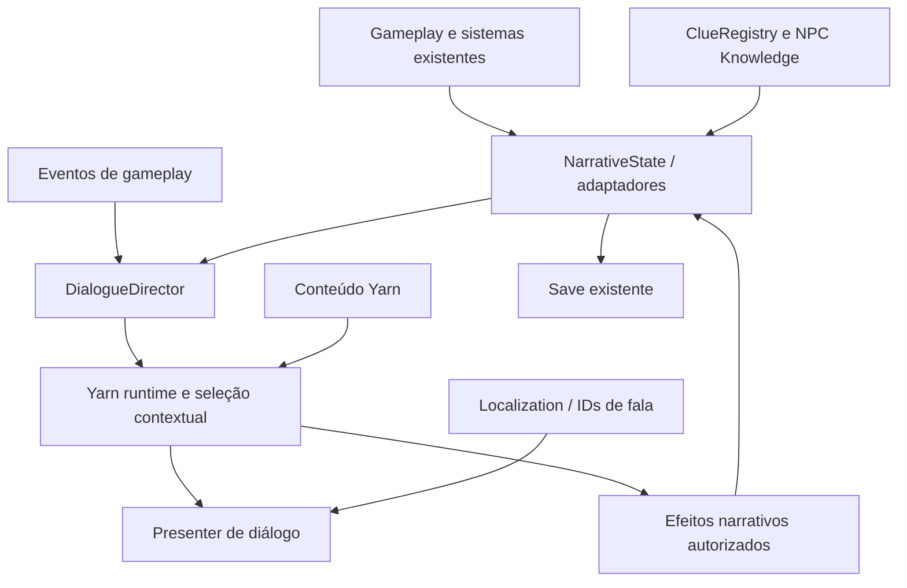

# Freyja — Implementação do sistema de diálogos contextuais

## 1. Missão

Atue como engenheiro sênior de gameplay Unity, arquiteto de software e especialista em sistemas narrativos. Implemente no projeto Freyja um sistema de diálogos orientado a contexto, fatos, eventos, pistas e conhecimento individual dos NPCs. O conteúdo deve ser determinístico, extensível, editável fora dos scripts C# e localizável por meio de arquivos de tradução.

Não entregue apenas uma proposta, documentação, tarefas ou pseudocódigo: implemente a primeira versão funcional, integre-a ao projeto, execute os testes disponíveis e produza evidências verificáveis. Trabalhe incrementalmente, preservando o funcionamento do jogo. Não invente a lore definitiva do Freyja.

### Resultado esperado para o jogador

- Conversar com NPCs e receber respostas coerentes com a evolução do jogo.
- Descobrir pistas em diferentes ordens e desbloquear novas perguntas e conversas.
- Perceber mudanças nas falas depois de acontecimentos, mudanças no mundo ou interações anteriores.
- Escolher respostas em conversas interativas, com consequências explícitas quando aplicável.
- Não ouvir spoilers de fatos que o personagem não poderia conhecer ou que ainda não podem ser revelados.
- Salvar e carregar o progresso sem perder descobertas, conhecimento compartilhado ou histórico relevante.
- Trocar o idioma sem alterar a lógica, as escolhas disponíveis ou o progresso narrativo.

## 2. Regras de execução e inspeção inicial

Antes de escrever código:

1. Leia `AGENTS.md` e demais instruções do repositório. Se houver Spec Kit, OpenSpec ou outro fluxo de especificação configurado, siga o fluxo existente. Não instale frameworks de agentes novos apenas para esta tarefa.
2. Verifique `git status`, versão do Unity em `ProjectSettings/ProjectVersion.txt`, `Packages/manifest.json`, `Packages/packages-lock.json`, estrutura de assemblies, cenas, prefabs e convenções do projeto.
3. Localize os sistemas existentes de interação, NPCs, inventário, quests, tempo/clima, eventos, persistência, UI, input, localização e testes. Identifique fontes de verdade e pontos reais de integração. Não assuma que todos esses sistemas existem.
4. Verifique se Yarn Spinner ou outra engine narrativa já está instalada. Consulte a documentação oficial correspondente à versão realmente utilizada, especialmente para storylets, saliency, funções, comandos, localização e armazenamento de variáveis. Não copie APIs ou sintaxe de outra versão sem verificar compilação.
5. Registre brevemente, em documento do projeto, o que foi encontrado, decisões de integração, dependências e riscos. Se houver conflito arquitetural, adapte a proposta ao projeto em vez de refatorar subsistemas não relacionados.
6. Se houver mudanças locais do usuário, preserve-as. Não faça `git reset`, `git clean`, descarte, rebase, push ou commit sem autorização específica. Não altere assets de produção fora do escopo.

Se o projeto tiver agentes configurados, distribua a execução assim: Game Designer avalia UX e coerência; Implementador altera código e assets; Validador revisa independentemente as alterações e executa os testes. Se não houver suporte a subagentes, execute esses três papéis em passagens separadas e documente a limitação. O validador deve procurar falhas, e não apenas confirmar o que o implementador declarou.

Use busca direcionada (`rg`, arquivos específicos, símbolos) e logs compactos. Evite ler toda a árvore do projeto, arquivos de cache, Library, assets binários ou repetir dumps extensos. Use MCP Unity quando disponível e realmente necessário para edição de cena, testes em Play Mode e capturas. Não dependa de ferramentas remotas para validar a lógica pura.

## 3. Decisão arquitetural

Preferência: **Yarn Spinner 3 + camada de domínio C# do Freyja + Unity Localization**, respeitando compatibilidade real do projeto.

- Yarn Spinner: autoria, execução de diálogo, escolhas, condições, storylets e integração de funções/comandos.
- Domínio C#: estado narrativo, conhecimento, regras de elegibilidade que pertencem ao gameplay, histórico, efeitos e persistência.
- Unity Localization (ou provedor de localização já adotado pelo projeto): resolução de textos localizados por ID estável.
- Arquivos `.yarn`: texto original e fluxo narrativo; CSV consolidado: intercâmbio com tradutores.

Use os mecanismos nativos do Yarn para agrupamento de nós e saliência quando compatíveis. Se a política requerida não couber na seleção nativa, implemente um adaptador mínimo ou estratégia personalizada sobre ela. Não crie dois motores independentes de seleção, nem mantenha duas cópias autoritativas das mesmas condições. Documente onde cada regra reside.

Se já existir um motor narrativo adequado, priorize reaproveitá-lo quando implementar os mesmos contratos com menor risco. Se Yarn 3 não for compatível ou sua instalação estiver bloqueada, isole a integração, explique o motivo, implemente o domínio e os testes que não dependem do pacote e não declare a integração concluída. Não utilize dependências pagas nem instale versões flutuantes/branches sem fixar uma versão ou revisão. Registre a dependência e a licença verificadas.

**Proibido:** LLM durante o gameplay; geração de falas em tempo real; chamadas externas de IA; novos serviços de backend; geração massiva de assets; duplicação de sistemas de inventário, quests, relógio ou save; criação de um editor visual de narrativa completo nesta primeira versão.

### Fluxo conceitual



O diagrama representa responsabilidades, não obriga a criar uma classe por caixa.

## 4. Domínio narrativo e fontes de verdade

Implemente contratos equivalentes aos abaixo, adequando os nomes à arquitetura do projeto:

| Responsabilidade | Contrato sugerido |
|---|---|
| Consultar fatos e estado | `INarrativeContext` / `NarrativeState` |
| Descobrir pistas | `IClueRegistry` |
| Conhecimento e comunicação | `INpcKnowledge` |
| Histórico de falas e conversas | `IDialogueHistory` |
| Orquestrar sessão de diálogo | `DialogueDirector` |
| Integrar a engine de diálogo | `IDialogueRuntime` / adaptador Yarn |
| Aplicar consequências | serviço de comandos narrativos |
| Exibir texto e escolhas | presenter integrado à UI |
| Salvar e carregar | adaptador do save existente |

Preferir classes C# puras para lógica de domínio; MonoBehaviours apenas nas fronteiras com Unity e componentes de cena. Respeitar assemblies, DI e padrões reais do projeto. Não introduzir um service locator global novo ou singleton obrigatório por conveniência.

### Fatos

Distinguir fatos persistentes de consultas derivadas. Exemplos conceituais:

| Chave | Tipo | Fonte |
|---|---|---|
| `story.chapter` | int | progressão existente ou estado narrativo proprietário |
| `clue.old_letter.discovered` | bool | catálogo/progresso de pistas |
| `world.storm.last_night` | bool | histórico de eventos climáticos |
| `quest.missing_boat.stage` | enum | quest system existente |
| `relationship.fisherman` | int | sistema de relacionamento existente ou módulo mínimo narrativo |
| `conversation.fisherman.intro.completed` | bool | histórico narrativo |

Use IDs estáveis, não nomes de objetos da cena, textos traduzidos ou referências de instância. Defina valores default explícitos e valide IDs desconhecidos durante autoria/teste. Evite `Dictionary<string, object>` sem tipagem/validação e evite criar uma DSL genérica de regras se o Yarn já satisfizer a necessidade.

O NarrativeState funciona como fachada de leitura e coordenação, não como cópia de todos os sistemas. A hora continua no relógio; a posse de itens continua no inventário; progresso de quests no sistema responsável. Utilize eventos existentes; caso não existam, crie o menor mecanismo necessário. Não faça polling de todas as falas de todos os NPCs a cada frame.

### Pistas e conhecimento

Separe explicitamente:

1. Verdade do mundo: o que aconteceu, independentemente de quem conhece.
2. Conhecimento do jogador: o que descobriu ou ouviu.
3. Conhecimento de cada NPC: o que testemunhou, ouviu ou acredita.
4. Histórico de comunicação: quem contou o quê, para quem e quando, se necessário para regras.

Uma pista descoberta não implica conhecimento automático do NPC. Uma pista mostrada deve atualizar a comunicação e o conhecimento conforme a ação narrativa explícita. Um NPC pode conhecer um fato antes do jogador, pode mentir e pode ter uma crença incorreta; não trate crença como confirmação da verdade do mundo. Na primeira versão, basta representar as distinções indispensáveis, sem construir simulação epistemológica complexa.

Cada pista precisa de ID, referência ao conteúdo descritivo localizável, origem ou fonte e registro persistente de descoberta. Adicionar relacionamentos entre pistas apenas quando houver uso real. Pistas críticas não devem depender de uma única fonte perdível, a menos que essa seja uma decisão consciente do design.

## 5. Storylets e política de seleção

Modele conversas como pequenas unidades narrativas independentes, agrupadas por NPC e canal/gatilho. Campos conceituais de uma unidade:

```yaml
id: demo.fisherman.letter_reaction
speaker: demo.fisherman
trigger: interact
entry: FishermanInteraction
priority: 80
repeat: once
conditions:
  - introduction_completed
  - player_has_clue: demo.old_letter
  - npc_knows_clue: demo.old_letter
on_revelation:
  - mark_information_shared: demo.letter_reaction
```

Este YAML é ilustrativo, não é um formato obrigatório nem um segundo arquivo de regras. Escolha uma única fonte de autoria para as condições: cabeçalhos/expressões Yarn ou metadados de domínio integrados à seleção. Metadados adicionais só devem existir se necessários.

### Seleção

Ao iniciar uma oportunidade de diálogo:

1. Determinar NPC, gatilho, disponibilidade, canal e contexto válido.
2. Filtrar unidades pelo escopo, pré-requisitos, conhecimento e política de repetição.
3. Classificar as elegíveis por prioridade explícita (quando aplicável), relevância/especificidade, menor recência de exibição e desempate estável ou RNG controlável e testável.
4. Selecionar um único conteúdo ou abrir um menu de tópicos elegíveis, conforme o tipo de interação.
5. Revalidar condições relevantes antes de iniciar conteúdo e aplicar efeitos que dependam de estado mutável.
6. Registrar início, linhas informativas efetivamente apresentadas/confirmadas, conclusão e cancelamento de acordo com a semântica da unidade.
7. Se não houver candidato, utilizar fallback válido do NPC ou não iniciar interação; nunca travar nem revelar conteúdo inelegível.

Prioridades iniciais configuráveis (sugestão, não regra da lore): 100 revelação crítica, 80 pista, 70 quest, 60 evento recente, 50 relacionamento, 30 reação ambiental, 10 cotidiano, 0 fallback. A primeira apresentação pode ser um pré-requisito obrigatório, independentemente da prioridade. Não deixe falas ambientais impedirem indefinidamente interações críticas.

Políticas: `Once`, `OncePerDay`, `Cooldown`, `OnStateChange`, `Repeatable` e `UntilAcknowledged`. Implemente na vertical slice pelo menos `Once`, `Repeatable` e uma política temporal (`Cooldown` ou `OncePerDay` conforme relógio existente). As demais podem ser entregues em etapa posterior, com contratos claros e sem falsas declarações de suporte. Use tempo do jogo para cooldowns narrativos quando adequado; controle de spam de UI pode usar tempo de sessão separado.

Uma conversa interrompida antes de uma revelação não pode marcá-la como consumida. Distinguir histórico de visita do Yarn de conclusão de negócio. Efeitos críticos devem ser idempotentes e associados à linha/ação confirmada ou ao checkpoint explícito; salvar de forma coerente com o estado narrativo. Não aplicar efeitos apenas ao abrir a conversa.

## 6. Integração Yarn e conteúdo de demonstração

Use arquivos `.yarn` versionados e Yarn Project conforme a versão instalada. Exponha ao runtime um conjunto pequeno de funções puras de leitura (nomes ilustrativos):

- `has_clue(clueId)`
- `npc_knows(npcId, clueId)`
- `was_shared(npcId, clueId)`
- `quest_stage(questId)`
- `relationship(npcId)`
- `is_time_period(period)`
- `world_fact(factId)` (se tipado de forma compatível)

Comandos autorizados e validados para descobrir pista, comunicar pista, confirmar revelação, alterar relacionamento ou avançar quest via API do sistema proprietário. Não permita execução arbitrária de métodos C# a partir dos arquivos de conteúdo. Funções usadas em condições não devem produzir efeitos colaterais.

Exemplo de intenção de autoria; ajuste a sintaxe e nomes à versão do Yarn, compile e valide na implementação:

```yarn
title: FishermanInteraction
when: has_clue("demo.old_letter") and npc_knows("demo.fisherman", "demo.old_letter")
---
Fisherman: Onde encontrou essa carta? #line:demo_fisherman_letter_001
-> Encontrei na praia. #line:demo_fisherman_letter_002
    Fisherman: Faz tempo que o mar não devolve algo assim. #line:demo_fisherman_letter_003
-> Você reconhece a letra? #line:demo_fisherman_letter_004
    Fisherman: Talvez. Preciso pensar. #line:demo_fisherman_letter_005
===

title: FishermanInteraction
when: always
---
Fisherman: Hoje parece um bom dia para pescar. #line:demo_fisherman_idle_001
===
```

O exemplo não especifica todo o fluxo de descoberta/comunicação; implemente os efeitos reais e suas confirmações no conteúdo de teste. Verifique se o runtime instalado aceita agrupamento de nós, IDs de linha e funções conforme escrito; se não, utilize a sintaxe oficialmente suportada. Não mantenha pseudocódigo como conteúdo de produção.

### Vertical slice obrigatória

Criar conteúdo demonstrativo, isolado por namespace/pasta `Demo` ou equivalente, com três NPCs, um pequeno mistério fictício, cinco pistas e aproximadamente 30–50 linhas (incluindo opções). Reutilizar NPCs/arte/UI existentes quando seguro, sem modificar a lore oficial. Se não houver NPC adequado, criar uma cena ou fixture de demonstração isolada, sem substituir cenas principais.

Exemplo de roteiro descartável: um barco desaparecido, carta encontrada na praia, relato do pescador, símbolo na igreja, registro do farol e objeto encontrado no cais. NPCs demonstrativos: pescador, responsável pela igreja e morador da vila. IDs e fatos devem ser marcados como `demo.*` ou equivalente.

A demonstração precisa provar: apresentação inicial, fallback, descoberta de pista, comunicação ao NPC, pergunta desbloqueada, reação contextual, uma escolha com efeito, uma revelação de uso único, conteúdo repetível, condição temporal, ordem alternativa de descoberta e persistência. Incluir caso no qual jogador possui a pista mas NPC não conhece, para garantir ausência de spoiler.

## 7. Interface, interação e canais

Integre com os mecanismos de interação, controles, câmera, UI e estados de gameplay existentes. Não substitua o sistema de input nem introduza um novo canvas global sem necessidade.

MVP: diálogo iniciado pelo jogador, nome do falante localizável, texto, avanço, escolhas e cancelamento quando permitido. Se há bloqueio de movimentação durante conversas, usar o contrato existente e restaurá-lo inclusive em erro, cancelamento ou troca de cena. Não deixar input preso, callbacks duplicados ou duas sessões interativas simultâneas. O jogo não deve depender de mouse se já tem controles de teclado/gamepad/touch.

Preparar extensão para ambient barks, conversas entre NPCs e eventos automáticos. Estes canais não precisam de implementação completa no MVP. Se um bark mínimo for implementado, deve ser não bloqueante, possuir cooldown e não interromper conversa interativa. Não construir um scheduler social completo nem cutscenes nesta tarefa.

Se suportar salvar no meio de diálogo não for viável com o save atual, adote fronteira explícita e segura: salvar após checkpoints/efeitos confirmados e retomar em ponto consistente (ou bloquear save durante sessão se o jogo já usar essa política). Nunca marcar como ouvido o conteúdo interrompido nem perder efeitos já confirmados. Documente a escolha.

## 8. Autoria e localização — requisito obrigatório

O texto original deve ficar em arquivos `.yarn` (ou formato textual equivalente da engine já adotada). Os textos dos NPCs não podem estar hardcoded em scripts C# ou prefabs de produção. UI genérica usa a localização existente. IDs de personagem, nó, pista, linha, opção e efeito não devem depender da tradução.

Adotar provisoriamente `pt-BR` como idioma fonte caso o projeto ainda não possua padrão; se houver outro, preservar e registrar. Preparar `en-US` como idioma secundário de teste (e arquitetura extensível a outros idiomas). Não produzir tradução de toda a lore nesta tarefa.

### Arquivo consolidado para tradução

Entregar um CSV real, versionável e utilizável por um tradutor, por exemplo `Assets/Freyja/Narrative/Localization/Exports/Dialogues.csv` (adapte a convenção existente). Colunas mínimas:

```csv
line_id,speaker_id,node_id,source_file,kind,context,source_hash,pt-BR,en-US,translation_status
demo_fisherman_letter_001,demo.fisherman,FishermanInteraction,Fisherman.yarn,line,Reacao a carta,EXAMPLE, Onde encontrou essa carta?,Where did you find that letter?,translated
```

A linha acima é apenas ilustrativa: gere o hash real e CSV válido, sem espaços espúrios. Usar UTF-8, escape correto de vírgulas, aspas, acentos e quebras de linha. Incluir opções, falas, nomes exibidos e textos narrativos auxiliares que estiverem no escopo, com identificadores estáveis. Caso nomes/UI venham de outra tabela, exportá-los por meio da mesma ferramenta ou indicar sua fonte sem duplicar a propriedade dos dados.

- Fonte autoritativa para texto base: conteúdo narrativo original; não permitir que CSV de tradução sobrescreva silenciosamente o fluxo Yarn.
- Fonte autoritativa para traduções: escolha e documente CSV consolidado ou tabelas nativas. Evite edição concorrente em dois lugares; export/import deve manter equivalência e não perder traduções.
- Integre ao formato nativo Yarn/Unity Localization através de exportador/importador ou adaptador mínimo, sem inventar um mecanismo de renderização de tradução paralelo.
- IDs não mudam quando texto é revisado. Detectar novas linhas, linhas removidas/órfãs, IDs duplicados e tradução desatualizada por hash do texto fonte (incluindo revisão de contexto se desejável).
- Preservar tradução existente durante reexportação; marcar `missing`/`stale` sem apagar silenciosamente conteúdo traduzido. Importação repetida deve ser idempotente.
- Validar placeholders/variáveis, marcação, opções, acentuação, caracteres especiais e strings vazias. Não interpretar tradução como lógica narrativa.
- Fallback para idioma fonte se ausente; registrar diagnóstico sem inundar logs. Idioma alternado não deve modificar save ou decisões de seleção.
- Preparar metadados úteis para tradutores (speaker, contexto, emoção/intenção quando disponível) e futuro áudio por ID de linha, sem implementar dublagem.

Disponibilizar operação de exportar e importar pela ferramenta/editor/menu ou fluxo nativo claramente documentado, e preferencialmente uma entrada automatizável em batchmode. Demonstrar round-trip de um CSV de teste e execução de diálogo nos dois idiomas.

## 9. Estrutura de arquivos sugerida

Adapte à organização do projeto e às assembly definitions existentes; não mova assets existentes sem necessidade.

```text
Assets/Freyja/Narrative/
  Runtime/
    State/
    Knowledge/
    Dialogue/
    Persistence/
    Localization/
  Content/
    Freyja.yarnproject
    Characters/
    Story/
    Quests/
    Ambient/
    Demo/
  Data/
  Localization/
    Exports/Dialogues.csv
    Tables/
  Editor/
  Tests/
    EditMode/
    PlayMode/
    Fixtures/
```

Arquivos de catálogo podem ser ScriptableObjects ou JSON tipado conforme convenções existentes; escolha uma abordagem só para cada fonte de dados. Mantenha IDs independentes de referências Unity para persistência. Não modifique manualmente YAML de cenas/prefabs se o editor ou MCP puder fazê-lo com segurança. Preserve `.meta` e GUIDs existentes. Organize documentação de implementação e autoria no local já utilizado pelo repositório.

## 10. Save e ciclo de vida

Persistir apenas estado narrativo necessário: pistas descobertas, conhecimento adquirido/compartilhado, efeitos aplicados, histórico semântico, contadores e timestamps de jogo usados nas políticas. Estado de gameplay derivado não deve ser duplicado. Integre ao save existente com schema/versionamento compatível; trate ausência de dados narrativos em saves antigos com defaults explícitos e sem sobrescrever outros módulos.

Proteger contra reexecução de efeitos em save/load, retry, cancelamento e mudança de cena. Inscrever/desinscrever listeners de eventos no ciclo de vida adequado. Não persistir objetos Unity, strings localizadas, índices frágeis de opções ou referências de runtime. Se não existir SaveSystem, crie uma interface e fixture funcional isolada para provar round-trip; documente a integração de produção pendente em vez de inventar um save global.

## 11. Narrative Debugger e autoria

Criar uma janela simples de Editor (ou integrar ferramenta de debug existente) que permita:

- Escolher NPC e gatilho e inspecionar contexto atual, pistas, conhecimento, histórico, horário e fatos relevantes.
- Exibir candidatos avaliados, elegibilidade, prioridades, seleção e motivos de rejeição quando disponíveis; para condições nativas opacas, informar o limite da introspecção, sem inventar resultados.
- Simular valores e eventos em fixture ou modo de teste isolado; não alterar save real nem conteúdo de produção por acidente.
- Executar uma conversa de demonstração e visualizar IDs de linha e idioma, ou fornecer caminho claro até a execução.
- Rodar validação de conteúdo/localização e apontar arquivos/IDs problemáticos.

Manter a ferramenta editor-only. Evitar criar um editor visual completo de grafos. Fornecer documentação curta para adicionar um NPC, uma pista, um storylet e uma tradução sem editar código do runtime quando as condições já existirem.

## 12. Validação automatizada e harness

Use Unity Test Framework e o harness já existente. Testes devem provar comportamento e falhar diante de regressões, não só checar existência de componentes. Use relógio fake, contexto controlável e fixtures determinísticas para evitar flakiness. Não use sleeps arbitrários para sincronização de UI.

### EditMode / domínio

| ID | Cenário | Aceite |
|---|---|---|
| N01 | Sem pista | fala/opção dependente inelegível |
| N02 | Jogador descobre pista, NPC não sabe | NPC não reage como se soubesse |
| N03 | Jogador comunica pista | conhecimento/registro atualizado uma vez e conteúdo liberado |
| N04 | Pistas descobertas em ordem A/B e B/A | ambas as rotas válidas e coerentes |
| N05 | Dois candidatos elegíveis | política determinística seleciona o esperado |
| N06 | Prioridade maior mas pré-requisito ausente | conteúdo não é selecionado |
| N07 | Once após revelação confirmada | não repete, inclusive após save/load |
| N08 | Cancelamento antes da revelação | conteúdo crítico permanece disponível |
| N09 | Cooldown ou novo dia | comportamento respeita relógio configurado |
| N10 | Sem candidato | fallback correto ou ausência de interação segura |
| N11 | Repetição de comando/efeito | efeito idempotente |
| N12 | Save antigo ou dados ausentes | defaults compatíveis sem perda de outros dados |
| N13 | Troca de idioma | mesmo conjunto de opções e progressão |
| N14 | CSV round-trip/reexportação | traduções preservadas; aspas, acentos e multiline válidos |
| N15 | Fonte revisada, tradução ausente | stale/missing detectados; fallback correto |
| N16 | Conteúdo inválido | erros apontam ID e arquivo |
| N17 | Conhecimento isolado | revelar ao NPC A não atualiza NPC B automaticamente |

Validação estática: IDs duplicados/desconhecidos, referência de nó ausente, funções/comandos não registrados, tipos inválidos, chaves de localização e placeholders incompatíveis, fallback inexistente onde obrigatório. Use o compilador Yarn para o que ele já valida. Detecte condições obviamente contraditórias e conteúdos inalcançáveis nos cenários simulados; não alegue provar alcançabilidade de toda a narrativa com análise limitada.

### PlayMode / integração visual

1. Abrir cena de teste ou ambiente integrado; iniciar conversa via interação real.
2. Avançar, escolher opção e observar efeito no estado e UI.
3. Descobrir/comunicar pista e voltar ao NPC; verificar nova fala.
4. Cancelar antes de confirmação, reabrir e concluir; verificar que não desapareceu indevidamente.
5. Salvar/carregar e repetir interação; comprovar histórico e efeitos.
6. Trocar idioma e abrir conversa; comprovar texto alternativo e mesma lógica.
7. Verificar texto longo, wrapping, nomes, opções clicáveis/selecionáveis, fallback e restauração de input. Testar nas resoluções/aspectos relevantes do projeto e respeitar eventual pipeline de câmera/render texture existente.
8. Se houver Unity/MCP/harness visual disponível, capturar imagens reais de diálogo inicial, escolha, reação após pista e idioma alternativo. Anotar cena, passos e resultado. Não usar mockups como evidência de execução.

Executar os testes existentes relevantes além dos novos. Se possível, executar Unity em batchmode seguindo o mecanismo/versão do projeto, com logs e resultado XML fora dos assets de produção. Se o editor estiver ocupado ou indisponível, não matar processo do usuário nem fabricar resultado; documentar os comandos e os testes que não foi possível executar. A etapa visual só é concluída após evidência real.

## 13. Plano incremental e critérios de passagem

### Etapa A — descoberta e base

Inspecionar projeto, registrar arquitetura escolhida, instalar/validar dependência se necessária, criar contratos mínimos e testes iniciais. Compilação sem novos erros antes de avançar.

### Etapa B — vertical slice jogável

Integrar domínio, pistas/conhecimento, histórico, seleção, Yarn e UI. Criar conteúdo demo, interação e escolha com consequência. Provar N01–N08, N10–N11 e N17. Preservar o gameplay anterior.

### Etapa C — localização e persistência

Implementar export/import CSV, idioma fonte e secundário, save compatível e política temporal. IDs permanentes, fallback e round-trip. Provar N09, N12–N16 e os cenários de save/load.

### Etapa D — ferramentas e validação final

Entregar debugger, validação de conteúdo, testes PlayMode, documentação de autoria e revisão de Game Designer/Validador. Corrigir defeitos encontrados e executar novamente os testes afetados. Não considerar concluído apenas porque scripts foram gerados.

### Backlog explícito (não obrigatório para o MVP)

Ambient barks completos, conversas NPC-NPC, reações automáticas complexas, todas as políticas extras de repetição, relações sociais avançadas, editor visual de pistas, dublagem e produção de conteúdo definitivo. Implementar apenas se já houver infraestrutura simples e sem comprometer a vertical slice. Registrar pendências concretas.

## 14. Definition of Done

A entrega só pode ser declarada completa se houver evidência de:

- Projeto compilando sem novos erros e dependências compatíveis/fixadas.
- Vertical slice executável com 3 NPCs, 5 pistas e aproximadamente 30–50 linhas demo, demonstrando diálogo contextual e escolhas.
- Ausência de spoiler no cenário testado, condições e consequências verificáveis, repetição e interrupção corretas.
- Conteúdo textual externo ao C# e CSV de tradução real exportável/importável com IDs estáveis e dois idiomas demonstráveis.
- Persistência integrada ao sistema existente ou limitação explicitamente marcada se o sistema não existir; round-trip comprovado no nível disponível.
- Debugger/validador de conteúdo e documentação de autoria.
- Testes automatizados e evidência PlayMode real; regressões relevantes analisadas.
- Alterações de cena e prefabs limitadas ao necessário; nenhum impacto não intencional conhecido no restante do jogo.

Se algum requisito não for atingido, declare `PARCIAL` ou `BLOQUEADO` para o item, com evidência, causa e próxima ação concreta. Não use “implementado”, “testado” ou “funcionando” para código que não compilou ou teste que não executou.

## 15. Entregáveis e relatório final

Entregue código, assets/configurações necessários, arquivos `.yarn`, CSV consolidado de tradução, fixtures, testes, debugger, documentação de autoria e especificação/registro de decisões dentro do repositório. A documentação deve indicar os caminhos reais e explicar como criar conteúdo sem editar C#, exportar/importar tradução, abrir demo, trocar idioma e executar o harness.

Ao concluir, apresente relatório conciso:

1. Arquitetura realmente adotada e divergências desta especificação.
2. Arquivos relevantes alterados/criados e caminho exato do CSV.
3. Como abrir a demo no Unity e reproduzir os cenários.
4. Versões de Unity/pacotes verificadas.
5. Testes executados, pass/fail, comandos e caminhos dos resultados/logs/capturas.
6. Parecer independente do Validador e do Game Designer, com defeitos encontrados e correções.
7. Limitações, riscos, requisitos não concluídos e próximos passos.
8. Resumo do `git diff --stat`, sem incluir arquivos não relacionados do usuário.

## 16. Referências técnicas

Use a documentação oficial e confirme a compatibilidade com o pacote instalado antes de escrever código. Não assuma que exemplos antigos representam a API atual.

- Yarn Spinner: https://www.yarnspinner.dev/
- Yarn Spinner para Unity: https://github.com/YarnSpinnerTool/YarnSpinner-Unity
- Documentação oficial Yarn: https://docs.yarnspinner.dev/
- Unity Localization: https://docs.unity3d.com/Packages/com.unity.localization@latest
- Unity Test Framework: https://docs.unity3d.com/Packages/com.unity.test-framework@latest
- Referência conceitual: apresentação da Valve, *AI-driven Dynamic Dialog through Fuzzy Pattern Matching* (GDC 2012), sobre regras de diálogo contextual.
- Referências de design: Hades (progressão e recência), Dredge (mistério costeiro), Firewatch (diálogos na exploração) e Disco Elysium (investigação não linear). Não copiar seus textos, personagens ou lore.

**Inicie agora pela inspeção do repositório. Siga as etapas até a entrega funcional, executando e validando o que estiver disponível no ambiente.**
