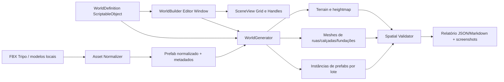

# Freyja World Builder — Especificação técnica v1.1 — offline, sem gastos com IA

**Estado:** proposta para implementação no projeto Unity existente  
**Escopo:** ferramenta de autoria de cenários no Editor, não um gerador de mundos em runtime  
**Mapa de demonstração:** 160 m × 160 m  
**Lote residencial padrão:** 12 m × 14 m  
**Topologia:** híbrida — Unity Terrain para relevo natural + meshes/prefabs para ruas, calçadas, fundações e edificações

> **Premissa:** o repositório Freyja não foi disponibilizado nesta conversa. Todos os caminhos abaixo são sugeridos. Antes de implementar, verificar `ProjectSettings/ProjectVersion.txt`, `Packages/manifest.json`, render pipeline, organização do código, cenas e testes existentes; adaptar sem quebrar o projeto.

## 0. Política de custo zero com geração externa (obrigatória)

**O World Builder NÃO é um cliente de geração de assets 3D.** Ele deve operar com modelos **já existentes no repositório ou adicionados manualmente pelo usuário**. Não tem permissão para gerar modelos no TripoAI, nem para mandar outro LLM/agente solicitar tais gerações.

- **PROIBIDO** chamar APIs, SDKs, MCPs, páginas web, automações ou qualquer ferramenta do TripoAI (ou serviços equivalentes de geração 3D), ainda que haja chaves, créditos ou conectores disponíveis.
- **PROIBIDO** gastar créditos, iniciar jobs de geração, tentar gerar modelos para a demo, solicitar credenciais/token ou sugerir geração paga como pré-requisito para concluir o MVP.
- **PROIBIDO** instalar clientes de serviços de geração 3D, implementar botões de “Generate with Tripo”, provisionar integrações futuras ou fazer chamadas de rede com finalidade de criar assets.
- **PERMITIDO:** importar FBX/GLB já exportados, conforme os formatos suportados no projeto, e normalizá-los **localmente**; construir objetos de prova com primitivas nativas da Unity ou malhas procedurais simples locais, sem rede e sem custo externo.
- Quando não houver modelo real, **usar proxies locais**, marcar `real_tripo_asset: not_provided` no relatório e **seguir implementando**. Não bloquear a demo nem requisitar mais créditos ao usuário.
- Para assegurar isso, inspecionar o diff e as dependências adicionadas ao final: nenhum endpoint, cliente, segredo, SDK, MCP ou fluxo de geração 3D externo deve ser introduzido pelo World Builder. O relatório final deve ter a linha `External 3D generation jobs: 0` e esclarecer se houve inspeção de integrações.

TripoAI aparece nesta especificação **somente como possível origem de arquivos que o usuário já criou**; o nome não representa uma integração com o serviço.

## 1. Problema e objetivo

O fluxo atual tenta gerar o chão completo com IA e, depois, ajustar construções sobre ele. Isso mistura geração artística com definição geométrica e provoca erros de escala, pivô, encaixe e altura.

**Objetivo:** garantir que a topologia do mundo, os lotes e a posição das casas sejam controlados por dados reproduzíveis. Modelos de terceiros, incluindo TripoAI, devem entrar como **prefabs normalizados**, substituíveis sem remodelar o mapa.

### Resultados observáveis

1. Criar/abrir uma cena isolada de demonstração de 160 × 160 m.
2. Ver um grid métrico e selecionar/criar/editar lotes de 12 × 14 m no Scene View.
3. Posicionar prefabs com snapping e detecção de conflito.
4. Nivelar apenas a área de apoio de cada edificação, preservando transição suave ao terreno externo.
5. Importar um FBX do Tripo (ou outro FBX), conferir dimensões, eixo frontal, pivô, materiais e criar um prefab normalizado sem alterar o original.
6. Rodar testes automatizados + inspeções espaciais + captura visual, produzindo um relatório auditável.
7. Reexecutar a geração com a mesma configuração sem duplicar objetos nem destruir trabalho manual.

## 2. Decisões de arquitetura

| Decisão | Regra |
|---|---|
| Unidades | 1 Unity unit = 1 metro; eixo Y para cima; coordenadas XZ para o chão |
| Origem | Centro lógico do mapa em (0, 0, 0); limites X,Z = [-80, +80] m |
| Terrain inicial | 160 × 32 × 160 m; origem do objeto Terrain = (-80, -4, -80) |
| Base plana | Cota global Y = 0 m; amostra de heightmap = 4/32 = 0,125 |
| Heightmap | Resolução inicial 257 × 257; amostras ordenadas em `[zIndex, xIndex]` / `[y,x]` da API |
| Relevo | Determinístico por `seed` + parâmetros serializados; hills sem interferir em fundações |
| Grid | Passo de 1 m para lotes e peças estruturais; opção 0,5 m para detalhes |
| Lote | 12 m em X local e 14 m em Z local (orientação explícita) |
| Casa de referência | Footprint máximo sugerido 9 × 11 m dentro do lote, sujeito a margem configurável |
| Via de referência | 5 m de largura; mesh independente do Unity Terrain |
| Prefabs | Raiz de instância em escala `(1,1,1)`, com camada filha de adaptação de escala/orientação |
| Fonte de verdade | `WorldDefinition` (ScriptableObject) + descritores de assets; cena é resultado editável controlado |
| Alterações | Nunca modificar assets originais do Tripo; não reescrever conteúdos fora do escopo da ferramenta |
| Renderização | Reusar URP/HDRP/Built-in existente, sem alterar pipeline de renderização |

**Observação:** 257 × 257 resulta em espaçamento horizontal de `160/(257-1) = 0,625 m`, suficiente para o protótipo, não para criar bordas de calçada geometricamente precisas. Calçadas, guias e ruas devem ser meshes.

## 3. Arquitetura proposta



### Organização inicial sugerida

```text
Assets/Freyja/WorldBuilder/
  Runtime/
    Data/              WorldDefinition.cs, LotDefinition.cs, RoadDefinition.cs,
                       AssetDescriptor.cs, WorldInstanceId.cs
    Geometry/          GridMath.cs, OrientedRectXZ.cs, TerrainSpace.cs,
                       FoundationStamp.cs, CollisionMath.cs
    Generation/        WorldGenerator.cs, TerrainGenerator.cs,
                       InfrastructureGenerator.cs, LotPlacementService.cs
    Validation/        WorldSpatialValidator.cs, ValidationIssue.cs
  Editor/
    WorldBuilderWindow.cs
    WorldBuilderSceneTool.cs
    TripoAssetNormalizerWindow.cs
    TripoAssetPostprocessor.cs    (somente quando realmente necessário)
    Validation/        WorldBuilderValidationRunner.cs, ScreenshotCapture.cs
  Tests/
    EditMode/
    PlayMode/
  Demo/
    Freyja_WorldBuilder_Demo.unity
    Freyja_WorldBuilder_Demo.asset
    Prefabs/
    Materials/
Docs/WorldBuilder/
  README.md
  KNOWN_LIMITATIONS.md
Artifacts/WorldBuilder/       (gerado, idealmente ignorado pelo Git)
```

Se o projeto já usa asmdefs, criar/adequar assemblies `Freyja.WorldBuilder`, `Freyja.WorldBuilder.Editor` e testes correspondentes. **Nunca** introduzir dependências de `UnityEditor` no assembly de runtime. Caso já exista convenção de pastas/namespaces, segui-la.

## 4. Modelo de dados

### WorldDefinition (ScriptableObject)

- `worldId` (ID estável), `schemaVersion`, `seed`.
- `worldSizeMeters = (160,160)`, `worldCenter = (0,0,0)`.
- `terrainHeight = 32`, `terrainOriginY = -4`, `heightmapResolution = 257`.
- `gridStep = 1.0`, `fineGridStep = 0.5`.
- `terrainProfile`: baseline, amplitude, frequência, octaves, offsets, máscara opcional.
- `lots[]`: registros persistentes, **não** dependentes apenas da hierarquia da cena.
- `roads[]`: traçados com IDs e pontos de controle, larguras e elevações.
- `materials`: referências opcionais às TerrainLayers e materiais de infraestrutura.
- `assetCatalog[]`: descritores e referências diretas ou GUIDs de prefabs normalizados.

### LotDefinition

- `id`: string única e estável.
- `centerXZ`: Vector2 em coordenadas globais.
- `sizeXZ`: Vector2 (padrão 12,14).
- `yawDegrees`: rotação ao redor de Y; inicialmente múltiplos de 90°, com suporte geométrico para ângulos arbitrários.
- `buildingFootprintXZ`: ex. (9,11), independente do tamanho total do lote.
- `setbackMeters`: recuo mínimo configurável; check de contenção no lote.
- `foundationY`: automático a partir de amostras / altura manual opcional.
- `foundationBlendWidth`: padrão 2 m (configurável).
- `prefab`: referência ao prefab normalizado.
- `manualOverrideFlags`: informação explícita de mudanças aprovadas pelo usuário.

### AssetDescriptor

- `assetId`, origem (`Tripo`, `Blender`, `Local`), caminho/identificador original.
- `sourceModel` (referência imutável), `normalizedPrefab`.
- `category` (building, vegetation, props...), `targetFootprintXZ`, altura mínima/máxima opcional.
- `forwardAxis` e correção de orientação, `pivotMode = BottomCenter`.
- `measuredBoundsMeters`, `appliedUniformScale`, avisos gerados.
- `visualFootprint` (considera beirais/varandas) vs `structuralFootprint` (fundação/ocupação).
- Versão/assinatura de normalização para não reprocessar sem necessidade.

### WorldInstanceId

Componente leve em instâncias geradas: `worldId`, `sourceRecordId`, `kind`, `generatorVersion`, `managedByWorldBuilder`. Serve para **atualizações idempotentes** e para não apagar objetos adicionados manualmente.

## 5. Geometria do terreno e fundações

### 5.1 Conversões

Para ponto global `(x,z)` dentro de [-80,80]:

```csharp
float u = (worldX - terrainOriginX) / terrainSizeX;
float v = (worldZ - terrainOriginZ) / terrainSizeZ;
int sampleX = Mathf.RoundToInt(u * (resolution - 1));
int sampleZ = Mathf.RoundToInt(v * (resolution - 1));
float normalizedHeight = Mathf.Clamp01((worldY - terrainOriginY) / terrainHeight);
// heights[sampleZ, sampleX], não [sampleX, sampleZ]
```

Ter um único serviço `TerrainSpace` para validar limites, converter coordenadas e consultar altura. `Terrain.SampleHeight` pode depender do offset do objeto, por isso usar convenção testada: `terrain.transform.position.y + terrain.terrainData.GetInterpolatedHeight(u, v)` para consultar cota mundial; testar contra referências conhecidas.

### 5.2 Geração de relevo

- Gerar uma matriz original de alturas a partir de seed fixa (demo: `1138`); guardar **snapshot/base procedural** ou regenerar base antes de aplicar stamps, evitando deriva acumulada.
- Mesclar uma faixa plana de via e lotes sobre o relevo procedimental; altura do relevo fica separada da altura dos meshes urbanos.
- `TerrainData.SetHeightsDelayLOD` durante operações interativas; `TerrainData.SyncHeightmap` ao concluir. Fora de edição interativa, `SetHeights` é aceitável; não sincronizar por amostra.
- Nunca alterar o `TerrainData` original de outras cenas. Gerar um asset exclusivo para a demo e registrar operações Undo quando apropriado.

### 5.3 Stamp da fundação

1. Converter posição de cada amostra de altura para coordenadas locais do lote (aplicar inversa do yaw).
2. Selecionar **área de apoio estrutural** `buildingFootprintXZ + margin` (sugestão 0,5 m por lado); não aplainar obrigatoriamente todo o lote.
3. Definir `targetY`: mediana das amostras base dentro do apoio, ou valor manual validado.
4. Dentro da área de apoio: definir exatamente `targetY`.
5. Fora da borda do apoio, por `blendWidth` (2 m): interpolar suavemente da área plana até a altura natural; usar `smoothstep` sobre a distância assinada até o retângulo orientado.
6. Fora da faixa de blend: preservar a altura natural.
7. Colocar a base do prefab/fundação em `targetY`. Em cortes e aterros elevados, criar **mesh de saia/fundação** até o terreno de contato quando necessário; denunciar desníveis exagerados.
8. Se dois stamps, ruas ou áreas de blend competirem, resolver por regra explícita: prioridade de via/infraestrutura e impedir conflitos geométricos; nunca permitir resultados dependentes da ordem de `foreach` sem documentação.

**Conflitos que exigem aviso ou bloqueio:** lote fora do mapa, lote sobreposto a outro lote, casa fora dos recuos, casa sobre a via, faixa de blend intersectando uma via sem tratamento, largura do talude excessiva, diferenciais de cota acima do limite configurado.

### 5.4 Infraestrutura

- **Ruas, guias, calçadas e fundações como meshes separadas** e reutilizáveis, não como deformação texturizada do Terrain.
- Caminho como segmentos ou spline simples; largura de via de 5 m. Perfil vertical derivado do relevo planejado, com limitação de inclinação; evitar ruas que flutuem ou atravessem abruptamente o solo.
- Garantir roadbed/recorte plano ou suave sob a rua, e suportar aterro/guia quando necessário.
- Checar intersections e sobreposição de lotes. Não implementar um editor viário completo antes de validar a demo.

## 6. Ferramenta no Editor

Menu recomendado: `Tools > Freyja > World Builder`.

### Componentes de interface

- **World:** selecionar/criar `WorldDefinition`, seed, dimensões (demo fixa por padrão), parâmetros de terreno.
- **Grid:** mostrar/ocultar, passo 1 m / 0,5 m, highlights a cada 5 m.
- **Lots:** criar, duplicar, mover, rotacionar, ajustar footprint, vincular prefab, remover.
- **Terrain:** gerar preview, resetar para base, aplicar stamps, visualizar altura/declive.
- **Assets:** normalizar modelo selecionado; inspecionar bounds, escala, orientação, pivô, materiais.
- **Validation:** executar checks, abrir issues e focar objeto problemático, capturar screenshots e exportar relatório.

### Interação em Scene View

- `SceneView.duringSceneGui` + `Handles` para desenhar grid, footprints, setas de frente e outlines de conflito.
- Edição via `Handles.PositionHandle`/`RotationHandle` ou controles equivalentes; respeitar `Undo` e marcar ScriptableObjects/scene dirty.
- Snapping por fórmula e **não apenas** confiar nas preferências globais do Editor.
- Prévia (ghost) antes de colocar prefab; vermelho/laranja se sobreposto.
- `PrefabUtility.InstantiatePrefab` para preservar vínculo com prefab.
- Nenhuma geração destrutiva disparada por `OnValidate` ou durante importação de scripts.

## 7. Pipeline TripoAI → Unity

### Entrada principal

**Preferir FBX** para o fluxo nativo de importação da Unity. Modelos GLB/GLTF só podem ser usados diretamente se houver importador apropriado (por exemplo, glTFast já integrado); senão, converter para FBX via Blender/Tripo. Não assumir suporte nativo a GLB.

### Normalização não destrutiva

1. Selecionar FBX em `Assets`/pasta de importação controlada.
2. Medir limites combinados da geometria usando transforms dos filhos, sem pressupor pivô ou hierarquia única; verificar `MeshRenderer` e `SkinnedMeshRenderer` se presentes.
3. Identificar eixo vertical/frontal e permitir correção manual. Normalizar para **Y up** e **forward +Z** no prefab final.
4. Calcular uma **escala uniforme** que faça o footprint caber em `targetFootprintXZ`, preservando proporções; não distorcer casas usando escala não uniforme automaticamente. Se a razão de aspecto for incompatível, avisar.
5. Criar prefab wrapper: `NormalizedRoot (1,1,1)` → `VisualOffset` com transformação de eixo, escala uniforme e deslocamento de pivô → `SourceModel` referenciado.
6. Reposicionar visual para centro inferior do footprint (bottom center); oferecer ajuste manual para modelos com base irregular.
7. Criar proxy collider opcional baseado em `structuralFootprint` e altura validada; não utilizar automaticamente mesh collider complexo.
8. Aplicar/reatribuir materiais conforme render pipeline existente; manter texturas e UVs se possível; sinalizar materiais ausentes ou rosa.
9. Persistir `AssetDescriptor` com dimensões originais/finais, escala e warnings.
10. Permitir regenerar o prefab sem perder referência nem destruir o arquivo de origem.

**Ponto de atenção:** modelos do Tripo podem incluir piso, terreno ou base decorativa. Não tentar inferir automaticamente que tudo deve tocar o chão; oferecer opção de excluir/marcar partes da base na revisão.

A API do Tripo suporta exportação FBX, `pivot_to_center_bottom`, `scale_factor`, orientação e controle de formato; porém o World Builder deve funcionar **offline**, sem depender de chave de API ou conexão ao serviço. A integração direta com API fica fora do MVP.

## 8. Geração da cena e idempotência

### Cena demo

- Criar uma cena nova, nome proposto `Freyja_WorldBuilder_Demo.unity`, sem sobrescrever cenas atuais.
- Estrutura:

```text
FreyjaWorldRoot
  Terrain
  Roads
  Sidewalks
  Foundations
  Lots
  Vegetation
  Debug (Editor-only / opcional)
```

- Demo mínima: uma rua (trecho de pelo menos 40 m), três lotes de 12 × 14 m, três casas (primitivas/proxies se não houver FBX), ao menos uma área de relevo, uma transição entre talude e lote e alguns props simples.
- Casas devem permanecer **prefab instances vinculadas**, com raízes em escala 1.
- Regeneração: sincronização por `WorldInstanceId`; remover/atualizar somente objetos gerenciados pela ferramenta; preservar filhos/manuais e registrar alteração.
- Seeds, parâmetros e GUIDs determinam as mesmas saídas, com arredondamentos estáveis e sem `UnityEngine.Random` global contaminando o projeto.
- Não descartar alterações manuais: opções `Preview`, `Apply`, `Rebuild Managed Only` e `Cancel`.

## 9. Validação automatizada

### Níveis de validação

| Nível | Check | Critério de aceite MVP |
|---|---|---|
| EditMode/unitário | world ↔ heightmap, com origem deslocada | round-trip dentro de 1 amostra e tolerância numérica |
| EditMode/unitário | snapping | posições múltiplas de 1 m e 0,5 m corretas, inclusive negativas |
| EditMode/unitário | retângulos orientados (SAT) | detecta sobreposição e contato de borda conforme política explícita |
| EditMode/unitário | footprint/fundação com yaw 0°/90°/45° | área central fica plana, blend local preserva exterior |
| EditMode/unitário | seed | mesmo input gera mesmos dados/hash |
| EditMode/integração | limites do mapa | nenhum lote/infra fora de X,Z [-80,80] sem issue |
| EditMode/integração | três lotes | exatamente três registros e três instâncias, sem duplicação após `Rebuild` |
| EditMode/integração | escala dos prefabs | root scale 1 e dimensão final dentro de tolerância configurada |
| EditMode/integração | encaixe da fundação | diferença vertical <= 0,05 m em 16 pontos de apoio (incluindo cantos e bordas) |
| EditMode/integração | overlaps | sem overlaps não autorizados em lotes/casas/vias |
| EditMode/integração | `Undo`/rebuild | operação reversível quando aplicável; cenas não gerenciadas preservadas |
| PlayMode/smoke | scene load/colisão | nenhuma exceção; terreno com `TerrainCollider`; casas acessíveis no teste básico |
| Captura visual | pelo menos três câmeras fixas | imagens reais 1280 × 720 quando graphics device disponível |
| Relatório | machine-readable | JSON + resumo Markdown, paths dos screenshots, status `passed/failed/not_run` |

### Validação visual que não finge sucesso

Capturas obrigatórias quando possível: `top_down`, `isometric_overview`, `street_level`. Salvar PNGs de 1280 × 720 em `Artifacts/WorldBuilder/<run-id>/` junto de parâmetros, versão Unity e identificadores dos assets. Capturar com `Camera + RenderTexture + Texture2D.ReadPixels` (ou equivalente compatível com projeto).

Comparação com baseline opcional: começar com diferenças métricas simples e metadados; se usar SSIM ou tolerância perceptual, documentar ferramenta e limiares. **Não afirmar que análise visual passou apenas porque screenshots existem**; marcar como `needs_review` quando não houver comparação automática confiável. Captura pode falhar em modo headless ou com `-nographics`; não marcar `passed` nessa situação: usar `not_run` + motivo.

### Execução CLI exemplificativa (macOS)

> Ajustar o caminho real do Unity Editor e a versão instalada. Os parâmetros podem variar conforme a versão do Unity Test Framework.

```bash
UNITY="/Applications/Unity/Hub/Editor/<versao-instalada>/Unity.app/Contents/MacOS/Unity"
PROJECT="/caminho/para/Freyja"
"$UNITY" -batchmode -quit -projectPath "$PROJECT" \
  -runTests -testPlatform EditMode \
  -testResults "$PROJECT/Artifacts/WorldBuilder/editmode-results.xml" \
  -logFile "$PROJECT/Artifacts/WorldBuilder/editmode-editor.log"

"$UNITY" -batchmode -quit -projectPath "$PROJECT" \
  -runTests -testPlatform PlayMode \
  -testResults "$PROJECT/Artifacts/WorldBuilder/playmode-results.xml" \
  -logFile "$PROJECT/Artifacts/WorldBuilder/playmode-editor.log"
```

A ferramenta deve fornecer `MenuItem` para teste/relatório manual e, se viável, um entrypoint estático para `-executeMethod` produzir relatório e screenshots. Não passar `-nographics` para os testes de captura.

### Contrato do relatório

```json
{
  "worldId": "freyja-demo",
  "seed": 1138,
  "mapMeters": [160, 160],
  "lots": 3,
  "unityVersion": "detectado-em-execucao",
  "checks": [
    {"id": "foundation-flatness", "status": "passed", "details": "maxDelta=0.03m"},
    {"id": "visual-baseline", "status": "needs_review", "details": "screenshots capturados; baseline inexistente"}
  ],
  "screenshots": ["top_down.png", "isometric_overview.png", "street_level.png"],
  "buildStatus": "passed",
  "testStatus": "passed"
}
```

Os valores acima são **exemplo de esquema**, não resultado real. Acrescentar `failed`/`not_run` com mensagens quando não executado, e separar falhas de compilação de falhas espaciais.

## 10. Contrato de desempenho / qualidade

- MVP responsivo no Editor para 160 × 160 m com três casas; registrar tempos de `Generate`, `Apply Stamps`, `Validate` em vez de fingir limiares universais.
- Nada de regenerar toda a heightmap a cada pequeno movimento do mouse; preview rápido + commit ao soltar.
- Evitar alocações excessivas por frame do Scene GUI.
- Cachear cálculos de footprints e bounds; invalidar apenas com mudanças relevantes.
- Testar a execução com GameObjects ausentes, prefabs nulos, mesh sem renderer, modelos com hierarquias profundas e caminhos inválidos.
- Preservar `.meta`, GUIDs e referências de cena.

## 11. Entregas e marcos

### M0 — Auditoria

Verificar versão Unity, packages, render pipeline, convenções, sistema de testes e cena atual. Documentar decisões/adaptações e baseline de build. **Não editar o cenário existente.**

### M1 — Dados, coordenadas e grid

ScriptableObjects, IDs persistentes, math testada, Editor Window, grid e handles, `Undo`.

### M2 — Terreno híbrido

Terrain com 257 amostras, seed, stamp para lotes e trecho de rua mesh. Isolar TerrainData e suportar rebuild seguro.

### M3 — Posicionamento de lotes e casas

Criação/edição de lotes, SAT, preview de overlaps, instâncias vinculadas, root scale 1 e fundação.

### M4 — Normalizador Tripo

FBX → descriptor → prefab wrapper; bounds, orientação, escala uniforme, pivô bottom-center, materiais/collider proxy e warnings. Validar com asset real se disponível; senão registrar pendência.

### M5 — QA automatizado

EditMode e PlayMode tests; relatórios JSON/Markdown; screenshots de câmeras fixas (quando possível); distinção entre execução real e pendência.

### M6 — Demonstração e documentação

Cena demo funcional, README com tutorial de uso, comandos e limitações; exemplos de parâmetros. Confirmar que a demo não mudou cenas existentes.

## 12. Critério de aceite final (Definition of Done)

- [ ] `Tools > Freyja > World Builder` abre no Unity sem erros.
- [ ] Existe cena DEMO separada contendo Terrain 160 × 160 m e três lotes 12 × 14 m.
- [ ] Grid 1 m funciona em posições positivas e negativas, com snap e handles.
- [ ] Casas são instâncias vinculadas a prefabs e mantêm roots em `(1,1,1)`.
- [ ] Terreno sob cada fundação é plano em tolerância <= 5 cm, com blend e sem voos/interseções visíveis.
- [ ] Ao modificar casas, basta trocar o prefab/descriptor, sem remodelar terreno manualmente.
- [ ] Um modelo FBX pode ser normalizado em prefab, preservando original, sem escala não uniforme automática.
- [ ] Colisões e limites do mundo geram erros acionáveis no relatório.
- [ ] Regenerar duas vezes mantém contagem e IDs; não altera objetos manuais.
- [ ] Testes unitários e integração rodam ou relatam de forma explícita por que não puderam rodar.
- [ ] Capturas reais e status visual são reportados honestamente.
- [ ] Há README com walkthrough para importar uma nova casa e colocá-la em lote.

## 13. Fora de escopo do MVP

- Geração automática de bairros completos ou ruas a partir de mapas reais.
- Toda integração de geração remota de modelos (TripoAI ou equivalentes), paga ou gratuita, inclusive via MCP, agente ou navegador.
- Auto-retopologia, correção inteligente de UV ou retexturização por IA.
- NavMesh, tráfego, simulação de pedestres e streaming de mundo aberto.
- Ferramenta genérica para terrenos com múltiplos tiles gigantes.
- Garantia de que qualquer modelo IA terá qualidade artística: normalizar geometria não substitui curadoria.

## 14. Documentação técnica consultada

- Unity, escala de modelos (1 unidade = 1 m): https://docs.unity.com/en-us/engine/6000.3/manual/assets-and-media/asset-types/models/creating-dccassets/preparing
- Unity, `SetHeightsDelayLOD`/`SyncHeightmap`: https://docs.unity.com/en-us/engine/6000.3/script-reference/unityengine/terraindata/setheightsdelaylod
- Unity, `PrefabUtility.InstantiatePrefab`: https://docs.unity.com/en-us/engine/6000.3/script-reference/unityeditor/prefabutility/instantiateprefab
- Unity, `SceneView.duringSceneGui`: https://docs.unity3d.com/jp/current/ScriptReference/SceneView-duringSceneGui.html
- Unity, `AssetPostprocessor.OnPreprocessModel`: https://docs.unity3d.com/ja/6000.0/ScriptReference/AssetPostprocessor.OnPreprocessModel.html
- Unity, Test Framework em linha de comando: https://docs.unity.com/en-us/engine/6000.3/manual/programming-environment/test-framework-introduction/running-tests/run-tests-from-command-line
- Tripo API, conversão/exportação FBX: https://developers.tripo3d.ai/en/docs/models-convert

**Nota de compatibilidade:** referências são versões contemporâneas; o Codex deve utilizar a API da versão instalada no Freyja, não copiar assinaturas de outra versão sem validar.
