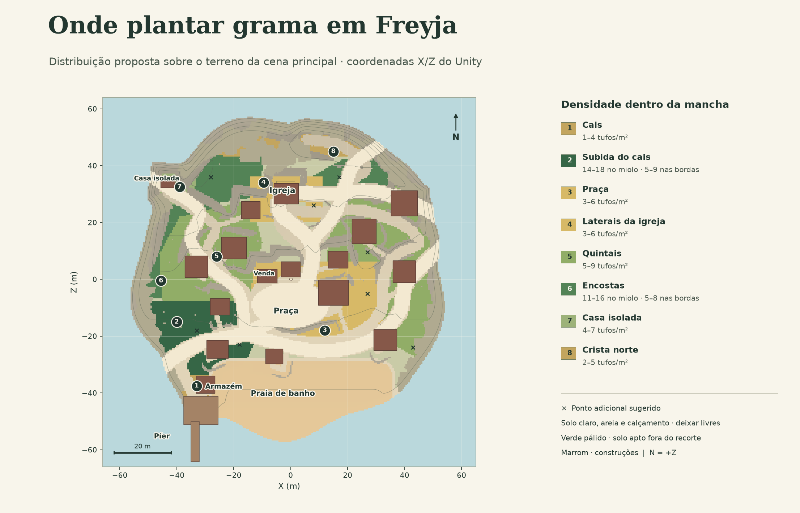

# Onde plantar grama em Freyja

**Proposta para avaliação** · 18/11/2026 · Cena `Ilha_Tripo_Caminhada_011`, grupo `Island023`

Concentrar os campos densos nas encostas suaves e na subida do cais. Isso preserva o efeito de vento do piloto onde ele aparece na câmera. Na chegada, na praça e na igreja, usar tufos baixos em pequenos pontos laterais para que o jogador leia o piso, as entradas e os marcos. A praia de banho, os costões nus e o eixo da escadaria ficam abertos.

A [revisão de cobertura aplicada](evidence/cobertura/validacao.md) aumenta a densidade e estende as manchas ao solo apto entre as zonas propostas abaixo.

## Densidade e posição

**Tufos/m²** é a densidade dentro da mancha. **Solo plantado** é a fração da zona apta escolhida para receber tufos. A [spec geral de vegetação](spec.md) mede a cobertura visual pela projeção das folhas. As coordenadas **X/Z**, em metros, são pontos sugeridos para iniciar manchas. O Y acompanha a altura do terreno.

| Zona | Solo plantado | Tufos/m² | Posições e composição |
| --- | ---: | ---: | --- |
| **1. Cais** | 10–20% | 1–4 | X −33, Z −37,5, na terra ao lado do armazém. Dois ou três grupos pequenos junto às transições de terra e pedra. Convés, passagem lateral, acesso e área de trabalho livres. |
| **2. Subida do cais** | 80–95% | 14–18 no miolo, 5–9 nas bordas | X −40, Z −15 e X −33, Z −18 nos taludes a oeste. X −18, Z −23 na faixa oposta. Priorizar manchas alongadas seguindo a inclinação. O piloto mais cheio é a referência visual desta zona. |
| **3. Praça e chegada pela trilha** | 15–25% | 3–6 | X 12, Z −18 no perímetro sul e X 27, Z −5 na faixa de terreno a leste. Tufos baixos e descontínuos. Piso da praça e acessos à venda e ao salão livres. |
| **4. Laterais da igreja** | 15–25% | 3–6 | X −9,5, Z 34 atrás da lateral oeste e X 8, Z 26 a leste. Grama rente junto ao solo lateral. Manter abertas a vista frontal, a escadaria e a chegada pela rua. |
| **5. Quintais** | 30–45% | 5–9 | X −26, Z 8 no núcleo oeste, X 27, Z 9,5 no leste e X 43, Z −24 na borda sudeste. Pequenos agrupamentos ao lado e atrás dos lotes. Entradas e áreas usadas pelos moradores têm chão aparente. |
| **6. Encostas** | 45–65% | 11–16 no miolo, 5–8 nas bordas | X −45,5, Z −0,5 na encosta oeste, X −28, Z 36 na parte alta e X 17, Z 36 a leste da igreja. Manchas maiores em terra suave, abrindo junto a pedras e trechos inclinados. |
| **7. Casa isolada** | 20–35% | 4–7 | X −39, Z 32,5, na faixa de terra ao sudeste da casa. Um grupo baixo lateral. Caminho de chegada, soleira e vista da casa permanecem abertos. |
| **8. Crista norte** | 10–25% | 2–5 | X 15, Z 45, em um bolsão de solo. Manchas baixas, espaçadas e interrompidas pela rocha. A posição do mirante do GDD segue em aberto. |
| **Água, praia de banho, rocha nua e pisos** | 0% | 0 | Baía sul, faixa de areia usada na chegada e no banho, costão sem solo, caminhos, degraus e calçamento. |

## Regras para ajustar cada mancha

- Começar com **30 cm livres desde a borda do piso** e **1,25 m em torno dos acessos e pontos de interação**. Ajustar pela passagem real e pelo enquadramento, principalmente nas portas, base de escadas e proximidade de pistas.
- Usar **10–20 cm de altura** nas áreas de circulação e marcos. Na subida e nas encostas, usar principalmente **15–35 cm**. Fazer as bordas rarearem ao longo de **1–2 m**, deixando a cor do solo aparecer na transição.
- Tomar os **6.539 tufos do piloto mais denso** como referência para o que é um campo cheio no jogo. A área apta no retângulo amostrado do piloto foi estimada em **423 m²**, o que dá cerca de **15 tufos/m²** em média. A [comparação na câmera do jogo](../../../029-grama-estilizada/specs/029-grama-estilizada/evidence/densidade/antes-e-depois.png) mostra esse resultado.
- Usar a densidade máxima em regiões de destaque. O culling por células e a redução de detalhe com distância continuam adequados como ponto de partida para um teste maior. O desempenho do piloto foi medido e o da distribuição da ilha inteira ainda precisa de validação.

## Base do mapa

Leitura da cena aberta no Unity com amostra em grade de **0,5 m**, incluindo altura, inclinação, camadas de solo, superfícies de caminhos, colisores e acessos. Aproximadamente **2.790 m²** passaram pelo filtro do piloto em toda a ilha. O filtro considera terra a partir de **Y 1,4 m**, declive de até **35°**, camada Grass com peso mínimo de **0,63** e solo exposto longe de caminhos e acessos. O recorte colorido indica onde procurar manchas dentro do solo apto. A implantação local das manchas e as folgas ainda dependem de revisão na câmera real.

Hortas, ruína e mirante seguem o [programa do GDD](../../../../GDD.md). As posições ainda não confirmadas ficaram fora do mapa de plantio. A cena foi consultada em modo de leitura.
