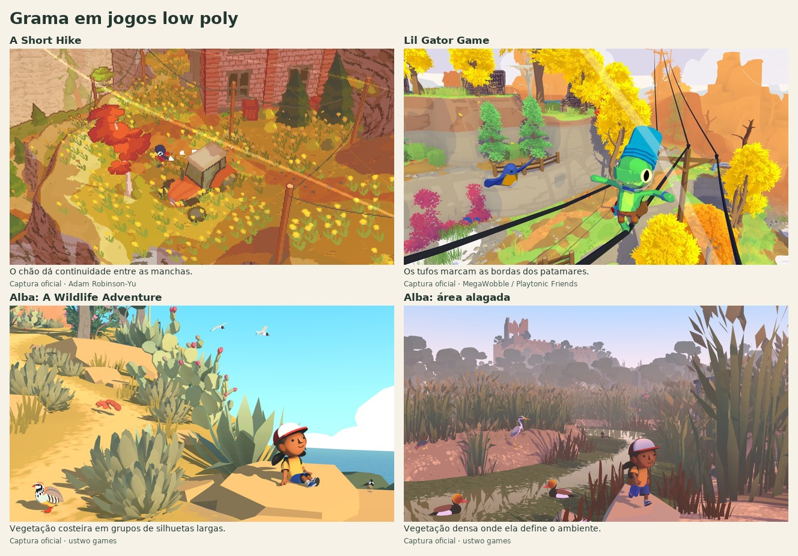

# Grama em jogos low poly

A proposta para Freyja é manter a sensação de campo cheio onde a câmera chega perto, distribuir tufos em grupos com bordas irregulares e deixar a cor do terreno dar continuidade às vistas distantes.

| Referência | O que observar |
| --- | --- |
| **A Short Hike** | No trecho junto ao acampamento, ocre e verde unem o terreno entre grupos de plantas. A câmera pixelada ainda lê o caminho e as silhuetas sem exigir o mesmo grau de detalhe por toda parte. Serve de referência visual para a subida do cais e vistas abertas. [Captura oficial](https://shared.akamai.steamstatic.com/store_item_assets/steam/apps/1055540/ss_4c7c9650606ac7b451f8d2e5b71b503649e43edc.1920x1080.jpg) · [Postmortem do desenvolvedor](https://gdcvault.com/play/1028679/) |
| **Lil Gator Game** | Na travessia suspensa, o verde dos patamares sustenta o campo de longe. As franjas de tufos marcam bordas legíveis e deixam as faces rochosas abertas. Serve de referência visual para concentrar silhueta onde a vegetação encontra a pedra e a trilha. [Captura oficial](https://shared.akamai.steamstatic.com/store_item_assets/steam/apps/1586800/ss_1d75565b08c0d6817284b699008c55cb2b3e0c6c.1920x1080.jpg) |
| **Alba: A Wildlife Adventure** | A costa tem grupos largos com intervalos de solo aparente. A área alagada ganha densidade porque a vegetação caracteriza aquele lugar. A ustwo documenta a cor e as transições no terreno, a geração de malhas nas áreas de grama e o uso de máscaras para retirá-las de escadas e passagens. É a referência técnica mais próxima de Freyja. [Costa](https://shared.akamai.steamstatic.com/store_item_assets/steam/apps/1337010/ss_042f8b0fd51f97b7e09d0e9e658c22b3304b0a2a.1920x1080.jpg) · [Área alagada](https://shared.akamai.steamstatic.com/store_item_assets/steam/apps/1337010/ss_7825153f6e71a6fcc3df12160e5871a3c8db51b6.1920x1080.jpg) · [Artigo de ambiente da ustwo](https://ustwogames.co.uk/news/the-environment-art-of-alba-a-wildlife-adventure/) · [Palestra técnica, seção de folhagem](https://www.youtube.com/watch?v=YOtDVv5-0A4&t=1150s) |

As observações de A Short Hike e Lil Gator Game vêm das imagens oficiais e descrevem a composição visível.

## O que a medição do Freyja mostra

No layout atual há 98.479 tufos. O culling envia em média 16.867 por quadro e chegou a 24.700 no percurso medido. Em 1.620 quadros por modo, com a câmera a 480×270 no Unity em um Apple M4 Pro, o tempo mediano passou de 1,39 ms sem grama para 1,70 ms com o modo otimizado. A mediana teve um acréscimo em todas as nove rodadas. O p95 ficou na mesma faixa, em 2,73 ms e 2,68 ms respectivamente. Esses números são do quadro inteiro no editor. O impacto no FPS do hardware-alvo precisa ser medido no Player. [Dados do percurso](evidence/cobertura/validacao.md) · [Amostras de quadro](evidence/cobertura/amostras.csv)

## Proposta para comparação em Freyja

- Concentrar tufos com vento no primeiro plano da subida do cais e nos encontros entre trilha, barranco e pedra. Manter alguns núcleos densos onde a câmera passa perto.
- Variar a densidade em manchas contínuas no espaço do mundo. Fazer a altura e o espaçamento mudarem gradualmente nas bordas e nas transições entre zonas. Usar a base oliva para unir as manchas e sustentar a grama distante.
- Comparar a versão atual com uma variante que busque **8–10 mil instâncias enviadas em média** no mesmo percurso. É uma meta de teste. Conferir a subida, a encosta e a crista em movimento, medir p50, p95 e pico de instâncias, e testar o Player no equipamento de referência.

[Variante aplicada e comparação no Player macOS](evidence/manchas/validacao.md)
