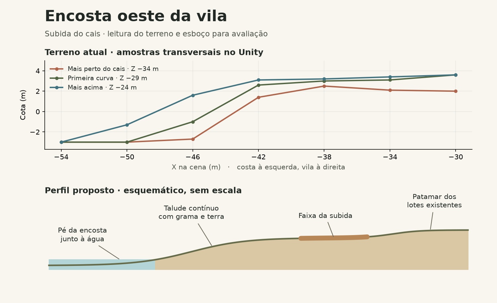

# Especificação — Relevo da encosta oeste

**Branch** `036-relevo-encosta`  
**Criada em** 18/11/2026  
**Estado** Piloto implementado e aguardando avaliação visual

## Cenário de uso e teste

### P1 — Entender o relevo ao subir do cais

Ao passar pela primeira curva, o jogador lê a faixa costeira abaixo do caminho e vê como a encosta sobe até os lotes existentes. Na [referência da vila](../017-referencia-terreno-tripo/vila-casa-isolada.png), a posição do caminho em relação ao mar e às áreas de grama explica a subida. Na [vista atual da costa](../../Artifacts/Encosta034/costa-antes.png), uma sequência de blocos domina a borda e o chão entre o caminho e a água aparece como uma faixa estreita.

Os perfis medidos mostram que o terreno sobe em posições diferentes ao longo da costa. Perto da primeira curva, a elevação muda de −1,0 m a 2,6 m entre X −46 m e −42 m. Alguns metros mais acima ao longo da costa, essa subida começa antes. A proposta acompanha essa variação com um pé de encosta mais baixo junto à água, um talude contínuo que se acomoda à curva e uma faixa mais regular para a subida. Os patamares devem aparecer onde os lotes precisam de apoio.

### Aceite

1. Vista da água, a base da encosta encontra a costa e a transição até o caminho é legível como uma forma contínua. Vista do percurso, a subida e os acessos aos lotes continuam claros.
2. Uma ida e volta do cais à praça, passando pela primeira curva e pela lateral do galpão, termina sem bloqueios novos, passos forçados sobre o talude ou perda de conexão com os acessos existentes.

## Requisitos

- **FR-001** — O piloto cobre o trecho oeste entre a chegada do cais e a saída da primeira curva. O perfil deve mostrar pé de encosta, talude, faixa de circulação e apoio dos lotes existentes.
- **FR-002** — A primeira versão deve permitir avaliar a forma do terreno com grama e terra exposta. Ocultar a fileira de pedras apenas no perímetro do estudo para facilitar a comparação. A necessidade de pedras pontuais será avaliada com os perfis e as vistas.
- **FR-003** — Preservar a faixa de areia, o encaixe com o cais, a largura útil da subida e o acesso às entradas existentes. Suavizar as transições nas duas extremidades do piloto.

## Critérios de sucesso

- **SC-001** — Comparar três seções transversais e dois pares de capturas, um vista da costa e outro da câmera do jogador. As transições entre costa, talude e caminho devem ser visíveis nas duas vistas.
- **SC-002** — Completar uma ida e volta entre cais e praça e conferir as entradas no trecho, mantendo a faixa de areia livre.

## Premissas

- Usar a referência para ler a relação entre os níveis. As cotas definitivas dependem dos acessos e das medidas da cena.
- Concentrar a revisão na primeira curva e no talude a oeste. A crista, a costa leste e o restante da ilha ficam para avaliação futura.
- O [perfil proposto](perfil-encosta.png) é um esboço para aprovação. A abordagem inicial recomendada é esculpir o terreno editável no Unity, com o piso do caminho e os acessos como referências de cota.
