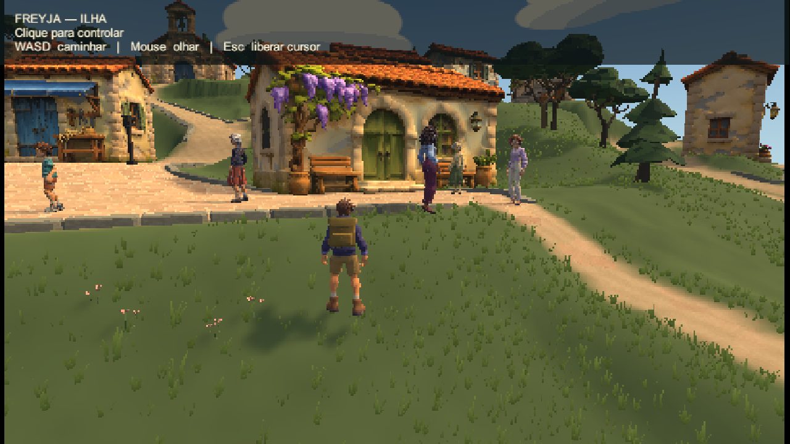
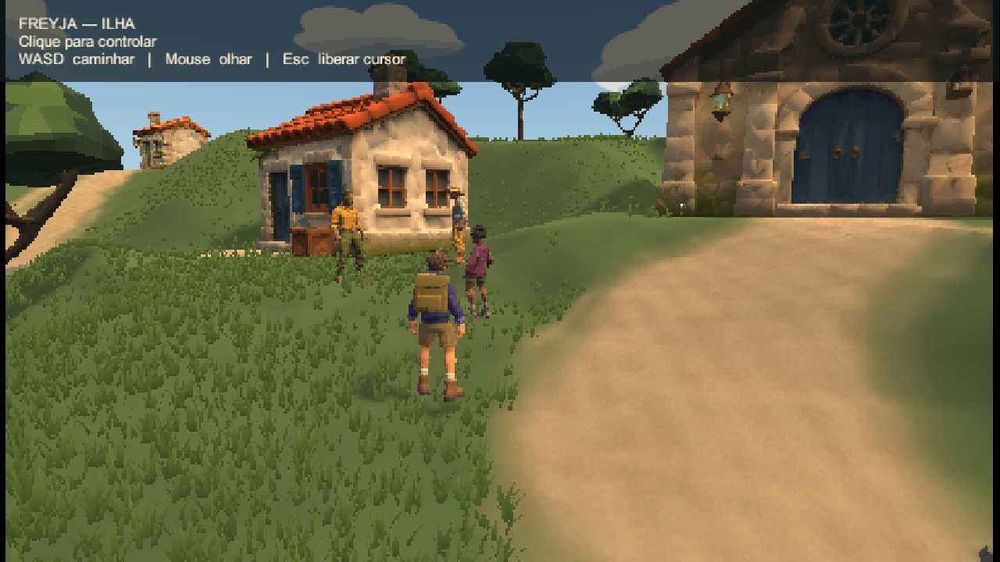
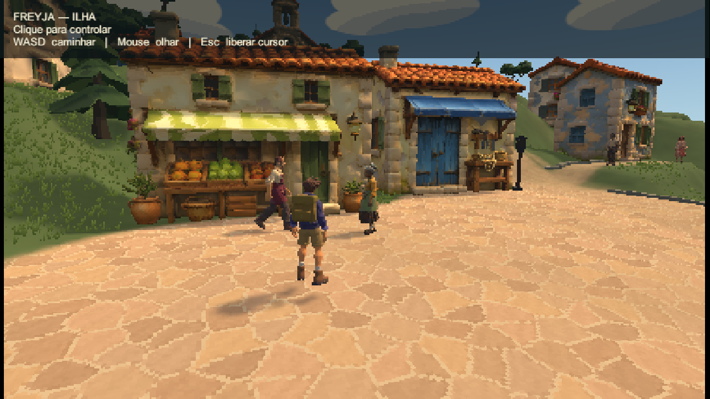
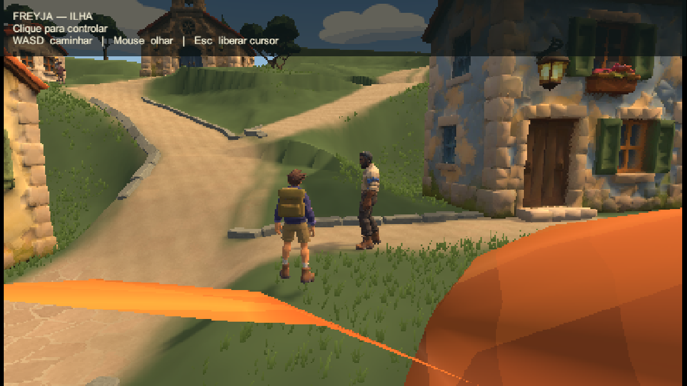
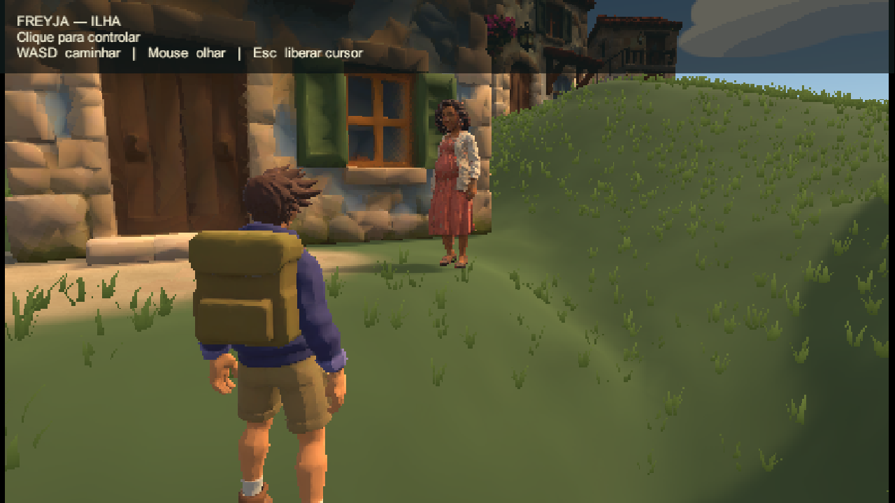

# Moradores de A1–A3 animados na ilha

Os dez moradores foram integrados na cena principal Ilha_Tripo_Caminhada_011.unity, sob Island023/Moradores060. A cena foi salva fora de Play Mode. Cada instância usa um prefab próprio, Avatar Humanoid, material Standard com a textura aprovada e um controlador com clipes de repouso e gestos da biblioteca instalada. A altura foi ajustada pela idade e pelas proporções, com o protagonista de 1,80 m como referência.

## Distribuição final

| Morador | Lugar | Posição X, Y, Z | Altura | Triângulos |
| --- | --- | --- | ---: | ---: |
| Duda Neves | Área junto à A1 | -7.00, 13.47, 20.00 | 1.53 m | 29606 |
| Elisa Neves | Venda | -6.40, 6.94, -2.90 | 1.60 m | 29324 |
| Joaquim Neves | Área junto à A1 | -8.80, 14.07, 22.20 | 1.72 m | 28290 |
| Mauro Neves | Área junto à A1 | -10.00, 13.82, 20.20 | 1.80 m | 28568 |
| Amélia Faria | Lateral do salão | 11.00, 6.04, -10.60 | 1.60 m | 29478 |
| Sara Faria | Área do salão | 17.50, 5.95, -11.50 | 1.68 m | 29098 |
| Tomás Faria | Largo | 8.00, 6.05, -12.00 | 1.30 m | 29256 |
| Helena Batista | Área externa da A3 | 18.30, 8.00, 3.20 | 1.66 m | 29394 |
| Ivo Batista | Acesso à A3 | 11.00, 7.95, 2.80 | 1.77 m | 28874 |
| Luana Batista | Área do salão | 15.00, 5.97, -12.80 | 1.70 m | 29294 |

## Verificações executadas

- Dez avatares válidos e humanoides, com as animações em reprodução. A conferência foi repetida após reiniciar Play Mode para verificar a persistência da integração.
- As malhas mantêm entre 28.290 e 29.606 triângulos. A inspeção de posição encontrou distância do ponto mais baixo da malha ao chão entre aproximadamente 0,6 e 2,9 cm na amostra final.
- As cápsulas dos dez moradores foram conferidas contra os elementos da cena. Nenhuma sobreposição de corpo com obstáculos foi encontrada.
- Foram percorridos seis trajetos em ida e volta pelo controlador do jogador, com entrada direcional sintética e execução de gravidade e colisões em Play Mode. Os trajetos finais cobrem cais–largo, salão, venda, aproximação da A1, acesso da A1 e A3.
- Na aproximação final cais–largo e largo–A1, a chegada ocorreu com o jogador apoiado no piso. Os pontos antigos do roteiro foram substituídos por aproximações compatíveis com as passagens atuais, mantendo os registros preliminares.
- A tira azul de Ivo, a gravidez de Helena e as roupas foram observadas na câmera do jogo. As capturas foram feitas com a iluminação diurna ajustada temporariamente durante Play Mode.
- Console sem erros de compilação ou execução dos personagens. O Unity registrou um aviso de acesso à conta do módulo de IA, independente do elenco.

## Arquivos

- Cena principal em Freyja/Assets/_Project/Scenes/Ilha_Tripo_Caminhada_011.unity na raiz principal do projeto.
- Modelos, materiais, texturas e controladores em Freyja/Assets/_Project/Art/Moradores060/.
- Prefabs em Freyja/Assets/_Project/Prefabs/Moradores060/.
- Fontes editáveis em Source/Blender/Moradores060/.
- Posições e resultados detalhados em evidence/placements.json, imports.json, animation-start.json, animation-end.json, reopen-playmode.json, circulation.json e final-state.json.

## Capturas

## Vídeo de revisão

[Vídeo do percurso pelos dez moradores](/Users/bruno.duartec/Documents/Projects/Freyja/Artifacts/Videos/Freyja-Moradores-A1-A2-A3-2026-11-19.mp4)

Captura visual da cena em Play Mode com um percurso de câmera livre, duração de 95 segundos, resolução 1280 × 720 e 30 quadros por segundo. O roteiro visita os dez moradores e exibe seus nomes durante as pausas. As animações foram avançadas de forma sincronizada com os quadros gravados. A iluminação de revisão usa o horário diurno durante a captura.

O MP4 foi reaberto com AVFoundation. Foram confirmados duração, dimensões, taxa de quadros e a decodificação de um trecho de cada morador. As amostras do próprio vídeo estão em evidence/video-decoded-00.png a video-decoded-09.png. O roteiro de capítulos está em evidence/video-chapters.json e a verificação está em evidence/video-verification.json.
